# StudyMate AI

[](https://www.python.org/)
[](https://fastapi.tiangolo.com/)
[](https://github.com/facebookresearch/faiss)
[](https://groq.com/)
[](LICENSE)

**A textbook-grounded AI study companion for Class 10 students.**

StudyMate AI answers questions about the supplied Class 10 study material. It
retrieves relevant passages from subject-specific FAISS indexes and sends those
passages to a Groq-hosted language model to generate an explanation with source
references. The project combines a lightweight browser interface with a Python
API and a local, file-based vector store.

> **Corpus note:** The available PDFs do not cover every chapter equally. The
> Social Science folder currently contains History material, and the supplied
> Science and Maths PDFs omit chapters noted in the application. Subject
> selection is not a guarantee that every topic in the curriculum is indexed.

## Table of contents

- [Project overview](#project-overview)
- [Features](#features)
- [Supported subjects and corpus coverage](#supported-subjects-and-corpus-coverage)
- [Technology stack](#technology-stack)
- [Architecture](#architecture)
- [How retrieval-augmented generation works](#how-retrieval-augmented-generation-works)
- [Storage and conversation history](#storage-and-conversation-history)
- [Project structure](#project-structure)
- [Installation and setup](#installation-and-setup)
- [Environment variables](#environment-variables)
- [API reference](#api-reference)
- [Student workflow](#student-workflow)
- [Screenshots](#screenshots)
- [Known limitations and future improvements](#known-limitations-and-future-improvements)
- [Tests](#tests)
- [Contributing](#contributing)
- [License](#license)
- [Author](#author)

## Project overview

Students often need explanations that connect directly to their prescribed
textbooks. StudyMate AI provides a chat interface where a student selects a
subject, asks a question, and receives a response based on passages retrieved
from the corresponding indexed PDFs. The answer view can show the source
filename, page, and retrieved text so students can check the explanation
against the study material.

The application has two parts:

1. A static HTML, CSS, and JavaScript frontend served by any static web server.
2. A FastAPI backend that validates requests, retrieves textbook passages, and
   calls the Groq Chat Completions API.

There is no SQL or document database. The searchable knowledge base is stored
in local FAISS index files included in the repository.

## Features

- **Textbook-grounded Q&A:** Prompts the language model to use retrieved
  passages for factual answers and to avoid inventing textbook citations.
- **Subject selection:** Choose Science, Maths, English, or Social Science.
- **Semantic retrieval:** Uses sentence-transformer embeddings, FAISS, and
  maximal marginal relevance (MMR) to select relevant passages.
- **Source references:** Displays retrieved PDF names and page numbers, with
  expandable source text when available.
- **Follow-up context:** Sends recent chat messages with a question and can
  rewrite follow-up questions into standalone retrieval queries.
- **Recent chats:** Saves successful conversations in the current browser's
  local storage; users can reopen or delete the saved list.
- **Voice input:** Uses the browser's Web Speech Recognition API when supported
  and permitted. Typed questions remain available in unsupported browsers.
- **Answer tools:** Renders Markdown and offers a copy-answer button.
- **Study navigation:** Provides subject-specific chapter lists and suggested
  questions. Selecting a chapter is a study focus only; it does not narrow
  retrieval to that chapter.
- **Service endpoints:** Includes health/readiness and subject-index
  availability checks.

The **Practice quiz** page is currently an informational placeholder. Quiz
generation is not implemented by the backend.

## Supported subjects and corpus coverage

The backend has a separate index path for each subject. The files currently
present in `Books/` and the chapter metadata in the frontend define the
available coverage.

| Subject | API subject ID | Current corpus notes |
| --- | --- | --- |
| Science | `Science` | Supplied Science PDFs; the frontend notes that Chapter 8 is not available. |
| Mathematics | `Maths` | Supplied Mathematics PDFs; Chapter 11 is not present. |
| English | `English` | Supplied prose, poetry, and literature PDFs listed in the chapter browser. |
| Social Science | `Social_Science` | The current folder contains History PDFs; Geography, Political Science/Civics, and Economics PDFs are not present. |

`Social Science` is accepted as an alias by the chat endpoint; the canonical
subject ID returned by the API is `Social_Science`. The chapter lists are
frontend metadata, not filters applied to the vector search.

## Technology stack

| Area | Technologies used |
| --- | --- |
| Frontend | HTML, CSS, vanilla JavaScript; [Marked](https://marked.js.org/) and [DOMPurify](https://github.com/cure53/DOMPurify) are loaded from jsDelivr for safe Markdown rendering. |
| API | [Python 3.13.7](https://www.python.org/), [FastAPI](https://fastapi.tiangolo.com/), [Uvicorn](https://www.uvicorn.org/), and [Pydantic](https://docs.pydantic.dev/). |
| LLM | Groq Chat Completions API using the configured model ID `openai/gpt-oss-120b`. |
| Embeddings | [Hugging Face sentence-transformers](https://huggingface.co/sentence-transformers/all-MiniLM-L6-v2), via `langchain-huggingface`; loaded on CPU when first needed. |
| Retrieval | [FAISS](https://github.com/facebookresearch/faiss) through `langchain-community`, using maximal marginal relevance. |
| PDF processing | `PyPDFLoader` and `RecursiveCharacterTextSplitter` from LangChain packages. |
| HTTP and configuration | [Requests](https://requests.readthedocs.io/) and [python-dotenv](https://github.com/theskumar/python-dotenv). |
| Tests | Python `unittest` and FastAPI's Starlette test client. |

Dependency versions are pinned in [`requirements.txt`](requirements.txt). The
embedding model is not bundled as model weights; Hugging Face downloads it the
first time the backend initializes embeddings.

## Architecture

```mermaid
flowchart LR
    subgraph Ingestion["Offline document preparation"]
        PDFs["Subject PDF files"] --> Loader["PyPDFLoader"]
        Loader --> Splitter["Recursive character splitter<br/>500-character chunks<br/>100-character overlap"]
        Splitter --> EmbedDocs["all-MiniLM-L6-v2 embeddings"]
        EmbedDocs --> Index["Per-subject FAISS index<br/>index.faiss + index.pkl"]
    end

    Student["Class 10 student"] --> UI["Static web app<br/>HTML + CSS + JavaScript"]
    UI -->|"POST /chat<br/>question, subject, recent history"| API["FastAPI"]
    API --> Tutor["Tutor orchestration"]
    Tutor --> Rewrite["Optional follow-up query rewrite<br/>Groq"]
    Rewrite --> EmbedQuery["Embed search query"]
    EmbedQuery --> Search["FAISS MMR retrieval<br/>up to 5 passages"]
    Index --> Search
    Search --> Context["Retrieved textbook context"]
    Context --> Generate["Groq Chat Completions<br/>openai/gpt-oss-120b"]
    Tutor --> Generate
    Generate --> Response["Answer + source metadata"]
    Response --> UI
    UI --> BrowserStore["Browser localStorage<br/>recent chats"]
```



The API lazily initializes the embedding model and subject FAISS index on
retrieval rather than at process startup. Initialization is guarded so
concurrent requests do not load the same embedding model or index repeatedly.
The configured reranker is disabled; MMR selection is performed by the FAISS
vector store.

## How retrieval-augmented generation works

### Document ingestion and indexing

The repository includes PDFs under `Books/` and prebuilt FAISS artifacts.
[`into_chunks.py`](into_chunks.py) walks the subject folders, loads PDFs with
`PyPDFLoader`, and splits pages using
`RecursiveCharacterTextSplitter(chunk_size=500, chunk_overlap=100)`. The
resulting chunks retain page metadata and are tagged with their subject and PDF
filename.

[`build_indexes.py`](build_indexes.py) groups chunks by subject, embeds them
with `sentence-transformers/all-MiniLM-L6-v2`, and writes LangChain FAISS
stores. The checked-in Science index is in `faiss_index/`; the other subject
indexes are under `faiss_indexes/`.

> **Index-builder limitation:** `build_indexes.py` currently contains a
> machine-specific absolute path to the Books folder and skips Science while
> building indexes. It is not a portable, complete rebuild command as-is. The
> prebuilt index files are required by the current API. Update the path and
> indexing workflow before using the script to rebuild indexes on another
> machine.

### Question retrieval and answer generation

1. The frontend submits the question, selected subject, session ID, and recent
   chat context to `POST /chat`.
2. The backend validates the request and resolves the subject to its index.
3. If conversation history is present and `GROQ_API_KEY` is configured, the
   tutor may ask the Groq model to rewrite a follow-up as a standalone search
   query. If rewriting fails, it falls back to the original question.
4. The query is embedded using `sentence-transformers/all-MiniLM-L6-v2`.
5. FAISS performs MMR retrieval with `k=5`, `fetch_k=10`, and `lambda_mult=0.5`.
6. The retrieved passages are included in a prompt that instructs the model to
   ground factual claims in that context, acknowledge gaps, and cite the
   provided PDF and page details.
7. The backend returns the answer and source metadata. The frontend renders the
   answer and lets the student expand the retrieved source text.

The answer model is called through the Groq OpenAI-compatible endpoint. The
repository does not include evaluation results or accuracy benchmarks.

## Storage and conversation history

- **No database is configured.** FAISS indexes and their LangChain metadata are
  local files.
- The frontend stores recent chats in browser `localStorage` (up to 30 chats,
  with up to 100 question-and-answer entries per chat). The active session ID
  is stored in `sessionStorage`.
- The main `/chat` endpoint receives recent history from the frontend; it does
  not persist conversations to a server database.
- The legacy `/ask` endpoint keeps its session history in process memory. That
  state is lost when the backend process restarts and is not shared across
  multiple workers.
- Chat questions and supplied history are sent to the configured backend and
  the Groq API to generate answers. Do not send sensitive personal information.

The FAISS loader uses LangChain's `allow_dangerous_deserialization=True` for
the accompanying `index.pkl` file. Only load index artifacts from a trusted
source.

## Project structure

```text
.
├── Books/
│   ├── English/                 # Supplied English PDFs
│   ├── Maths/                   # Supplied Mathematics PDFs
│   ├── Science/                 # Supplied Science PDFs
│   └── Social_Science/          # Supplied Social Science PDFs (History)
├── faiss_index/                 # Science index: index.faiss and index.pkl
├── faiss_indexes/
│   ├── English/
│   ├── Maths/
│   └── Social_Science/
├── frontend/
│   ├── index.html               # Application UI and static chapter content
│   ├── script.js                # Chat, API calls, browser storage, voice input
│   └── style.css                # Responsive visual styles
├── tests/
│   └── test_api.py              # API, CORS, tutor, and frontend-config tests
├── api.py                       # FastAPI routes, validation, CORS, session locks
├── Tutor.py                     # Embeddings, retrieval, query rewrite, Groq call
├── into_chunks.py               # PDF loading and chunking helper
├── build_indexes.py             # FAISS index-building script (see limitation above)
├── test.py                      # Manual FAISS retrieval experiment
├── Tutor_backup.py              # Legacy backup; not used by the API
├── requirements.txt             # Pinned Python dependencies
├── .python-version              # Python version used by the project
├── .gitignore
├── LICENSE
└── README.md
```

## Installation and setup

### Prerequisites

- Python **3.13.7** (see [`.python-version`](.python-version)).
- Git.
- A Groq API key for answer generation. Create and manage keys in your Groq
  account; do not put a real key in source code or commit it.
- Internet access the first time the embedding model is downloaded and when
  sending requests to Groq.

### 1. Clone the repository and create a virtual environment

```bash
git clone https://github.com/Sumant915/StudyMateAI.git
cd StudyMateAI
python -m venv .venv
```

Activate the environment:

```bash
# macOS / Linux
source .venv/bin/activate

# Windows PowerShell
.\.venv\Scripts\Activate.ps1
```

### 2. Install dependencies

```bash
python -m pip install --upgrade pip
python -m pip install -r requirements.txt
```

### 3. Configure the environment

Copy the root-level [`.env.example`](.env.example) to `.env`, then add your own
Groq API key. `.env` is ignored by Git.

### 4. Start the backend

From the repository root, with the virtual environment active:

```bash
uvicorn api:app --reload --host 127.0.0.1 --port 8000
```

The API is available at `http://127.0.0.1:8000`. FastAPI's interactive
documentation is at `http://127.0.0.1:8000/docs`.

### 5. Start the frontend

Open a second terminal at the repository root and serve the static frontend:

```bash
python -m http.server 5500 --directory frontend
```

Open [http://127.0.0.1:5500](http://127.0.0.1:5500). When the page is opened
from `localhost` or `127.0.0.1`, the frontend sends API requests to
`http://127.0.0.1:8000`. For other hostnames, the current frontend
configuration uses the deployed API URL in `frontend/script.js`.

The first successful retrieval may take longer because the embedding model and
FAISS index are initialized on demand. A deployment's liveness response does
not prove that model download, retrieval, or Groq inference will succeed.

## Environment variables

Copy [`.env.example`](.env.example) to `.env` in the repository root. The
template contains placeholders, not credentials:

```dotenv
# Required for query rewriting and answer generation
GROQ_API_KEY=replace_with_your_groq_api_key

# Optional comma-separated additional browser origins for the API
# Local origins and the configured production frontend are already defaults.
CORS_ORIGINS=
```

| Variable | Required | Purpose |
| --- | --- | --- |
| `GROQ_API_KEY` | Yes, for tutor responses | Bearer token used for Groq Chat Completions requests. |
| `CORS_ORIGINS` | No | Comma-separated additional allowed origins. Trailing slashes are removed and duplicate origins are ignored. |

Never commit `.env` or paste a real key into an issue, screenshot, or README.
Set production secrets through the hosting provider's secret/environment
configuration. If the frontend is hosted on a different origin, add that
origin to `CORS_ORIGINS`.

## API reference

The API is served by `api:app`. The browser application uses `POST /chat`;
`POST /ask` is a legacy Science-only endpoint.

| Method | Path | Purpose |
| --- | --- | --- |
| `GET` | `/` | Basic service-running response. |
| `GET` | `/health` | Liveness plus readiness/configuration indicators. |
| `GET` | `/subjects` | Subject names and whether both index files are present. |
| `POST` | `/chat` | Subject-aware, textbook-grounded chat used by the frontend. |
| `POST` | `/ask` | Legacy Science-only question endpoint with in-memory session history. |
| `GET` | `/docs` | Interactive OpenAPI documentation generated by FastAPI. |
| `GET` | `/openapi.json` | OpenAPI schema generated by FastAPI. |

### `GET /`

Example response:

```json
{
  "status": "running",
  "message": "Class 10 AI Tutor backend is running."
}
```

### `GET /health`

Reports `status` separately from `ready`/`readiness`. Readiness requires a
configured Groq key, all subject index files, and an initialized embedding
model. Calling this endpoint does not itself load the embedding model.

### `GET /subjects`

Example response shape:

```json
{
  "subjects": [
    { "id": "Science", "name": "Science", "index_available": true },
    { "id": "Maths", "name": "Maths", "index_available": true },
    { "id": "English", "name": "English", "index_available": true },
    {
      "id": "Social_Science",
      "name": "Social Science",
      "index_available": true
    }
  ]
}
```

`index_available` checks for both `index.faiss` and `index.pkl`; it does not
load the embedding model or verify that Groq is available.

### `POST /chat`

The `subject` field accepts `Science`, `Maths`, `English`, `Social_Science`, or
the alias `Social Science`. `chat_history` is an optional list of user and
assistant messages (maximum 100). `session_id` is optional and is used to
coordinate requests for the same client session.

Example request:

```json
{
  "question": "What is a chemical reaction?",
  "subject": "Science",
  "chat_history": [],
  "session_id": "example-session-id"
}
```

Example response shape:

```json
{
  "answer": "A textbook-grounded explanation appears here.",
  "subject": "Science",
  "subject_id": "Science",
  "sources": [
    {
      "pdf_name": "jesc101.pdf",
      "page": "1",
      "subject": "Science",
      "source_text": "Retrieved passage text appears here."
    }
  ],
  "session_id": "example-session-id"
}
```

The `chapter` source field may also be present when available in index
metadata. Requests require a non-empty question; unsupported subjects return
`400`, invalid request data returns `422`, and configuration, retrieval, or
upstream model failures return an appropriate error status.

### `POST /ask` (legacy)

This endpoint accepts a question and a required session ID. It always searches
the Science index and keeps history in backend process memory.

```json
{
  "question": "Explain this concept.",
  "session_id": "example-session-id"
}
```

It responds with `answer`, `sources`, and `session_id`. Prefer `/chat` for new
clients because it supports subject selection and caller-provided history.

## Student workflow

1. Open the web app and choose a subject from the selector.
2. Type a textbook question, choose a suggested prompt, or use voice input if
   the browser supports speech recognition and microphone access is granted.
3. Submit the question. The frontend sends the question, subject, session ID,
   and recent context to the backend.
4. The backend retrieves passages from the selected subject's index and asks
   the language model to explain the answer using that context.
5. Read the answer, expand **Textbook sources** to inspect citations and
   retrieved passages, or copy the answer.
6. Reopen a recent conversation from the browser's **Recent chats** panel, or
   delete the saved history from that browser.

The chapter browser provides a study focus and chapter information; it does not
restrict the search to the selected chapter.

## Screenshots

No screenshots are currently included in the repository. Add genuine captures
of the running application under a path such as `docs/images/` and link them
here when available. Do not use mockups as screenshots of implemented
functionality.

## Known limitations and future improvements

These are possible future improvements, not features currently implemented:

- Add a portable, configurable indexing command that rebuilds every subject
  index, including Science, from a user-selected Books directory.
- Add chapter-scoped retrieval; the current chapter selection is only a UI
  study focus.
- Implement the quiz workflow with a backend endpoint and validated,
  source-grounded questions.
- Expand the Social Science collection beyond the currently supplied History
  material and complete any missing subject chapters.
- Add persistent, user-managed conversation storage if cross-device history
  is required; current chat history is browser-local or process-local.
- Add retrieval and answer evaluation using a documented test set before
  publishing quality or performance claims.
- Improve deployment observability and verify cold-start inference on the
  selected hosting plan.

## Tests

The API tests use mocks for tutor responses and do not require a Groq key or a
model download. `httpx` is used by the Starlette/FastAPI test client and is not
listed in `requirements.txt`, so install it for tests:

```bash
python -m pip install httpx
python -m unittest discover -s tests -v
```

## Contributing

Contributions are welcome:

1. Open an issue describing the bug or proposed change.
2. Fork the repository and create a focused branch.
3. Keep changes scoped, preserve existing behavior, and avoid committing
   `.env`, virtual environments, caches, or unlicensed source material.
4. Run the test command above and describe the results in your pull request.
5. For changes to retrieval, prompts, or corpus coverage, explain how the
   change was checked; do not claim quality improvements without evidence.

## License

The repository includes the [MIT License](LICENSE), with a 2026 copyright
notice. Check the terms for third-party textbooks and other supplied materials
separately; the repository's software license does not automatically relicense
those materials.

## Author

**Sumantra Singh** — B.Tech student in Artificial Intelligence and Machine
Learning.

- [GitHub](https://github.com/Sumant915)
- [LinkedIn](https://www.linkedin.com/in/sumantra-singh-a85956317/)
